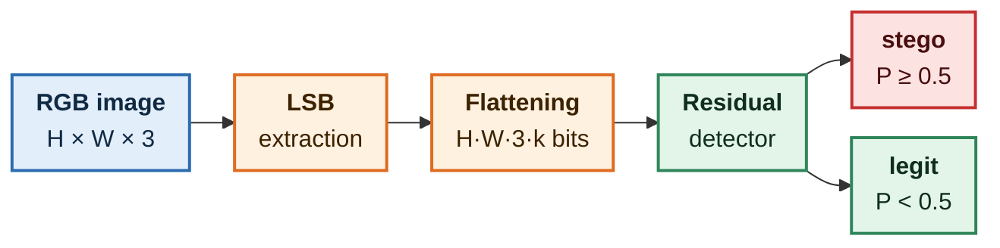
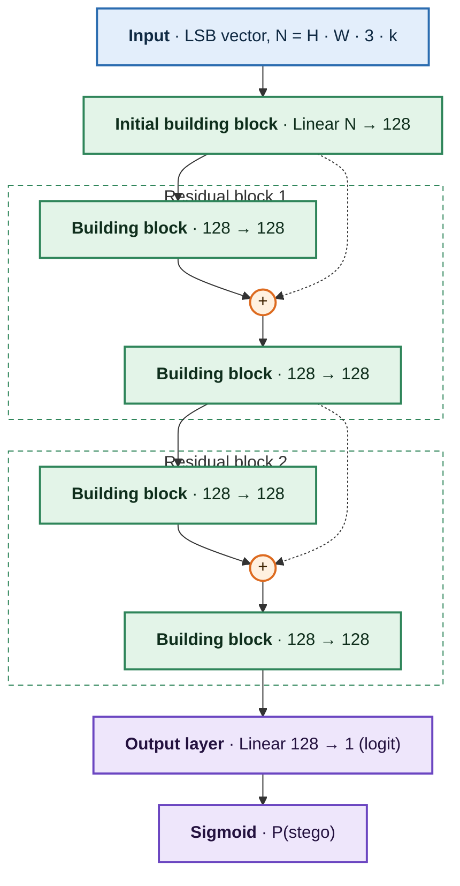

<div align="center">

# StegoDetector

**Detection of AI-Generated Stegomalware Carriers for Fake News and Misinformation Spread**


[Overview](#overview) •
[How it works](#how-it-works) •
[Model](#model-architecture) •
[Installation](#installation) •
[Usage](#usage) •
[Citation](#how-to-cite)

</div>

---

## Overview

StegoDetector is the PyTorch implementation of the residual neural detector introduced in the paper ***Data-Efficient Detection of Stegomalware in Real and AI-Generated Fake News*** (SAI4OID 2026). It checks whether an RGB image is **legit** (clean) or **stego**, meaning it carries a malicious payload hidden with LSB steganography. It works on both real and AI-generated news images.

| Aspect | Description |
|---|---|
| **Task** | Binary image classification: `legit` vs. `stego` |
| **Input** | RGB images, real or AI-generated |
| **Features** | Least significant bits (LSBs) of every RGB channel |
| **Model** | Residual fully connected neural network |
| **Output** | Probability that the image hides a payload |
| **Framework** | PyTorch |

---

## Publications

The **same residual detector** contained in this repository is used in both of the following papers.

| Venue | Paper |
|---|---|
| 📄 **SAI4OID 2026**<br>*main reference* | B. Valente\*, S. L. Sanna\*, L. Caviglione, M. Guarascio.<br>***Data-Efficient Detection of Stegomalware in Real and AI-Generated Fake News.***<br>2nd International Workshop on Sustainable Artificial Intelligence for Addressing Online Information Disorder (SAI4OID), Naples, Italy, September 2026.<br><br>Introduces the concept, the detection pipeline and the architecture described in this README. |
| 📄 **DISA** | S. L. Sanna\*, B. Valente\*, M. Choraś, L. Caviglione, M. Guarascio.<br>***Stegomalware Detection in the Deepfake Era.***<br>Emerging Problems in Disinformation Analysis (DISA).<br><br>Uses the same detector to study whether a detector trained only on real images keeps working when deepfake images appear at test time, and whether mislabelled synthetic images injected into the training set can poison it. |

<sub>\* Equal contribution.</sub>

---

## Background

Malware often hides scripts, configuration files or URLs inside ordinary-looking images using steganography. This class of threats is known as *stegomalware*. Generative AI makes it easy to produce many credible carrier images at scale, and fake-news pictures can be spread together with misinformation.

---

## How it works

The detector does not look at what the image shows. It looks only at the **least significant bits** of each pixel, which are the bits modified when a payload is hidden with LSB steganography.



| Step | Stage | What happens |
|---|---|---|
| **1. RGB image** | Input | An image of size H × W. Each pixel has three 8-bit channels (R, G, B). |
| **2. LSB extraction** | Low-level features | The last `k` bits of every channel are kept (`k = 1` by default). All the other bits are discarded. |
| **3. Flattening** | Low-level features | The extracted bits are concatenated into one binary vector of length H · W · 3 · k. |
| **4. Residual detector** | High-level features | A residual fully connected network learns the statistical traces left by the hidden payload. |
| **5. Prediction** | Output | A sigmoid turns the network output into P(stego). Above the threshold (0.5 by default) the image is `stego`, otherwise `legit`. |


---

## Model architecture



Every **building block** has the same structure:


| Component | Description |
|---|---|
| **Initial building block** | Projects the LSB vector (size N) onto 128 hidden units. |
| **Residual blocks** (× 2) | Two building blocks each. The dotted arrow is an **identity skip connection**: the block input is added (**+**) to the output of the first building block, and the sum goes through the second building block. |
| **Output layer** | A single neuron that returns a logit. The sigmoid is applied inside the loss during training and when computing probabilities at inference time. |

The model is implemented as `StegoDetectorResidualTorch` in [`models/stego_detector_residual.py`](models/stego_detector_residual.py). The LSB extraction and flattening are done during preprocessing ([`utils/data_utils.py`](utils/data_utils.py)), so the network receives the already flattened bit vector.

### Training setup

| Setting | Value |
|---|---|
| Loss | Binary cross-entropy (`BCEWithLogitsLoss`) |
| Optimiser | RMSprop, learning rate `1e-3` |
| Scheduler | `ReduceLROnPlateau` on the validation loss |
| Epochs / batch size | 20 / 256 |
| Hidden units / dropout | 128 / 0.025 |
| Saved checkpoints | Lowest validation loss and highest validation ROC-AUC |

---

## Repository structure

```text
StegoDetector/
├── config.py
├── requirements.txt
├── models/
│   └── stego_detector_residual.py
├── train/
│   ├── training_main.py
│   └── train.py
├── inference/
│   ├── inference_main.py
│   └── inference.py
└── utils/
    ├── data_utils.py
    ├── models_utils.py
    ├── sampling.py
    └── plot_utils.py
```

---

## Requirements

- **Python 3.10 or newer**
- **A CUDA GPU is recommended** for training. Without one, the code runs on CPU automatically.

The Python packages are listed in [`requirements.txt`](requirements.txt):

| Package | Minimum version | Used for |
|---|---|---|
| `torch` | 2.0 | Neural network, training and inference |
| `numpy` | 1.24 | Array handling and LSB feature extraction |
| `pandas` | 2.0 | Inference results (CSV / JSON) |
| `scikit-learn` | 1.3 | ROC-AUC and PR-AUC metrics |
| `matplotlib` | 3.7 | Training / validation loss plot |
| `pillow` | 10.0 | Image loading |

---

## Installation

```bash
git clone https://github.com/bernardo9830/StegoDetector.git
cd StegoDetector

python -m venv .venv
source .venv/bin/activate          # Windows: .venv\Scripts\activate

pip install -r requirements.txt
```

---

## Data

The data is not included in the repository. Two **separate** folders are used, both in the repository root:

| Folder | Content | Used by |
|---|---|---|
| `dataset_stego/` | Labelled images (clean and stego) of real and AI-generated news | Training |
| `inference_data/` | New, unlabelled images to analyse | Inference |

```text
StegoDetector/
├── dataset_stego/
│   └── fake_news/
│       ├── fake/
│       │   ├── train/
│       │   ├── val/
│       │   └── test/
│       └── real/
│           ├── train/
│           ├── val/
│           └── test/
└── inference_data/
    ├── image_001.png
    ├── image_002.png
    └── ...
```

| Folder | Content |
|---|---|
| `fake_news/real/` | Real news images |
| `fake_news/fake/` | AI-generated news images |
| `legit/` *(inside every split)* | Clean images, label `0` |
| `attack/` *(inside every split)* | Stego images, label `1` |

Every `train/`, `val/` and `test/` folder contains the two sub-folders `legit/` and `attack/`. To choose which images to train on, set `data_folder` in `config.py` to `./dataset_stego/fake_news/real` or `./dataset_stego/fake_news/fake`.

> [!IMPORTANT]
> **All images must have the same size.** For inference, it must match exactly `config["inference"]["image_size"]` (default: 600 × 330 pixels) and the size used for training. Images are never resized, because resizing would destroy the LSB signal.
>
> Supported formats: `.png`, `.jpg`, `.jpeg`, `.bmp`, `.webp`. Images are converted to RGB.

---

## Configuration

All settings are in [`config.py`](config.py). The most important ones:

| Section | Key | Default | Description |
|---|---|---|---|
| `data` | `data_folder` | `./dataset_stego/fake_news/real` | Folder containing the `train` / `val` / `test` splits (`real` or `fake`) |
| `data` | `legit_folder` / `stego_folders` | `legit` / `["attack"]` | Class sub-folders inside each split |
| `data` | `k_lsb` | `1` | Number of least significant bits extracted per channel |
| `experiment` | `seed` | `230782` | Global seed (Python, NumPy, PyTorch, cuDNN) |
| `experiment` | `model_space` | `output/models-separate_k1_residual_real` | Where checkpoints and training history are saved |
| `model` | `model_type` | `residual` | Detector architecture |
| `model` | `dl_size` / `drop_pcg` | `128` / `0.025` | Hidden layer width / dropout rate |
| `training` | `num_epochs` / `batch_size` | `20` / `256` | Training length and batch size |
| `training` | `learning_rate` | `1e-3` | Initial learning rate |
| `training` | `threshold` | `0.5` | Decision threshold on the stego probability |
| `inference` | `image_folder` | `./inference_data` | Folder with the images to analyse |
| `inference` | `image_size` | `(330, 600)` | Expected image size as **(height, width)** |
| `inference` | `output_csv_path` | `./output/inference_results/inference_results.csv` | Where predictions are written |
| `sampling` | `use_sampling` / `fractions` / `sampling_k` | `False` / `None` / `None` | Optional training on a fraction of the data |

---

## Usage

Run all commands from the repository root.

### ① Train the detector

```bash
# Linux / macOS
PYTHONPATH=. python train/training_main.py
```

```powershell
# Windows (PowerShell)
$env:PYTHONPATH = "."; python train/training_main.py
```

For each epoch, the script prints loss, accuracy, ROC-AUC and PR-AUC on the training and validation sets, plus the current learning rate. At the end it produces:

| File | Content |
|---|---|
| `output/<model_space>/best_model_stego_detection_by_loss.pt` | Checkpoint with the lowest validation loss |
| `output/<model_space>/best_model_stego_detection_by_auc.pt` | Checkpoint with the highest validation ROC-AUC |
| `output/<model_space>/history.npy` | Per-epoch metrics (`np.load(path, allow_pickle=True).item()`) |
| `plot_train/train_val_loss.pdf` | Training vs. validation loss plot (log scale) |

### ② Train on a fraction of the data *(optional)*

To study how much training data the detector needs, enable sampling in `config.py`:

```python
"sampling": {
    "use_sampling": True,
    "fractions": [0.01, 0.02, 0.04, 0.08, 0.16, 0.32],
    "sampling_k": 0.04,          # fraction used in this run; must be one of `fractions`
},
```

Then run the training command again.

> [!TIP]
> The subsets are **stratified** (the clean/stego ratio is preserved) and **nested** (each smaller subset is contained in the larger ones), so runs with different fractions are directly comparable. Each run is saved in its own sub-folder, e.g. `output/<model_space>/sampling_0_04/` and `plot_train/sampling_0_04/`.

### ③ Run inference on new images

Put the images to analyse in `inference_data/`, then run:

```bash
# Linux / macOS
PYTHONPATH=. python inference/inference_main.py
```

```powershell
# Windows (PowerShell)
$env:PYTHONPATH = "."; python inference/inference_main.py
```

The script loads the best-by-validation-loss checkpoint. The results are printed as JSON and saved as CSV in `output/inference_results/inference_results.csv`, sorted by decreasing stego probability:

```json
[
    {
        "image_path": "inference_data/image_042.png",
        "attack_probability": 0.9731,
        "predicted_label": "attack"
    },
    {
        "image_path": "inference_data/image_007.png",
        "attack_probability": 0.0214,
        "predicted_label": "legit"
    }
]
```

| Column | Meaning |
|---|---|
| `image_path` | Path of the analysed image |
| `attack_probability` | Probability that the image is stego (0–1) |
| `predicted_label` | `attack` if `attack_probability ≥ threshold`, otherwise `legit` |

---

## Notes and limitations

- **Consistent settings.** `k_lsb`, image size and model settings must be the same for training and inference, otherwise the input size does not match the checkpoint.
- **Lossless images.** LSB payloads do not survive lossy compression or resizing. Use lossless formats (e.g. PNG) and do not resize images before analysis.
- **Scope.** The detector learns the traces left by the embedding methods present in its training data. Performance on other steganographic techniques or image sources should be tested separately.
- **Reproducibility.** Seeds are fixed and cuDNN runs in deterministic mode. Bit-exact results across different GPUs and library versions are still not guaranteed.

---

## How to cite

If you use StegoDetector in your research, please cite the SAI4OID paper:

```bibtex
@inproceedings{valente2026stegodetector,
  author    = {Valente, Bernardo and Sanna, Silvia Lucia and Caviglione, Luca and Guarascio, Massimo},
  title     = {Data-Efficient Detection of Stegomalware in Real and AI-Generated Fake News},
  booktitle = {Proceedings of the 2nd International Workshop on Sustainable Artificial Intelligence for Addressing Online Information Disorder (SAI4OID)},
  address   = {Naples, Italy},
  month     = sep,
  year      = {2026}
}
```

---

## Acknowledgements

This work was supported by project **PERUN (101225653)** – *Protecting Sensitive Cyber Ecosystems from Upcoming Next Generation and AI-generated Malware Threats*, under the Horizon Europe Programme funded by the European Union.

---

## License

No license has been specified yet. Until one is added, all rights are reserved by the authors. Please contact them before reusing the code.
